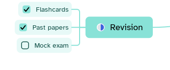

[Manual](../README.md) › [Topic contents](README.md) › Checkboxes

# Checkboxes

A checkbox turns a topic into a task to tick off.

## Add checkboxes

1. Select one or more topics.
2. Click **Add a checkbox to the topic** in the topic bar, or press <kbd>Ctrl</kbd>+<kbd>Alt</kbd>+<kbd>T</kbd>.

Or: **Insert content** › **To-do** › **Checkbox**, or start a title with `- [ ] ` (`- [x] ` for a task already done).

## Tick and remove

- Click the box to mark the task done or not done.
- Right-click the box › **Remove checkbox**.

The box works the same in the outliner.

> [!TIP]
> To show how far a branch has come, add a **Progress** [marker](markers.md) to its topic.
