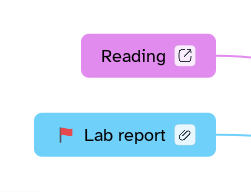

[Manual](../README.md) › [Topic contents](README.md) › Files

# Files

Attach documents to a topic; they are copied inside the map and travel with it.

## Attach files

1. Select a topic.
2. Choose **Insert content** › **File…** and pick one or more files.

Or: drag files from your computer onto a topic.

A paperclip appears on the topic, with the number of files when there are two or more. Hover it to see their names.

## Open, save and remove

Click the paperclip. For each file:

| Item | What it does |
|---|---|
| **Open** | Opens the file in its app. Programs and scripts ask first. |
| **Save as…** | Saves a copy on your computer. |
| **Remove** | Takes the file out of the map. |

**Add files…** at the bottom attaches more.

> [!TIP]
> If you change a file you opened from the map, Mentis asks whether to **Update** the copy in the map.
