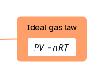

[Manual](../README.md) › [Topic contents](README.md) › Formulas

# Formulas

Write an equation in LaTeX and see it drawn in the topic.

## Insert a formula

1. Select a topic.
2. Choose **Insert content** › **LaTeX formula…**.
3. Type the code, for example `\frac{a}{b}` or `\sqrt{x}`. The preview shows the formula, or what is wrong.
4. Choose a **Background** (white or transparent) and click **Insert**.

The formula takes the place of a picture: size, place and style work as for an [image](images.md).

> [!TIP]
> In a title or a note, a short formula can stay in the text between dollar signs: `$x^2 + y^2$`.

## Change a formula

Double-click it to edit the code, then click **Save**.

Or: right-click › **Edit formula…**, **Copy LaTeX code**, **Copy as image**, **Rotate 90°** or **Remove formula**.
