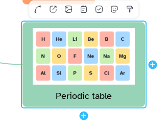

[Manual](../README.md) › [Topic contents](README.md) › Images

# Images

Put a picture inside a topic: a diagram, a photo, a scan of your notes.

## Add an image

1. Select a topic.
2. Click **Insert an image in the topic** in the topic bar, or press <kbd>Ctrl</kbd>+<kbd>Shift</kbd>+<kbd>I</kbd>, and choose the file.

Or: **Insert content** › **Image…**, or drag an image file onto a topic. The picture is kept inside the map file.

> [!NOTE]
> A topic holds one picture, one sticker or one formula: adding one replaces the other.

## Size and place

- Click the picture, then drag a corner handle; proportions stay. <kbd>Esc</kbd> during the drag puts the old size back.
- Drag the picture above, below, left or right of the title.
- Right-click › **Rotate 90°** or **Remove image**, or press <kbd>Delete</kbd>.

## Style the image

Select the picture, then open the **Style** page of the side panel:

| Option | What it does |
|---|---|
| **Dimensions (px)** | **Width**, **Height**, **Keep proportions**; **Reset size** restores the first size. |
| **Border** | No border, Solid, Dashed or Dotted; colour and **Thickness (px)**. |
| **Shadow** | A soft shadow under the picture. |
| **Opacity** | From 0 to 100 %. |
| **Reset style** | Removes border, shadow and opacity; the size stays. |
