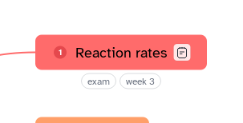

[Manual](../README.md) › [Topic contents](README.md) › Labels

# Labels

Labels are short tags under a topic, such as `exam`, that group topics across the map.

## Add labels

1. Select a topic.
2. Press <kbd>Ctrl</kbd>+<kbd>Shift</kbd>+<kbd>L</kbd>, or choose **Insert content** › **Label**.
3. Type the labels, separated by commas, or click one under **Labels in this document**.
4. Press <kbd>Enter</kbd> or click outside.

**Auto sort** keeps them in alphabetical order. Case does not matter: `Exam` and `exam` are one label.

## Use labels

- Click a label to change the labels of its topic.
- Right-click › **Highlight related topics**: topics without that label fade until you click the map or press <kbd>Esc</kbd>.
- Right-click › **Remove** takes the label off.
