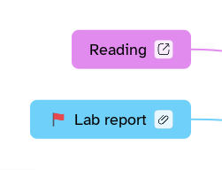

[Manual](../README.md) › [Topic contents](README.md) › Links

# Links

A link takes you from a topic to a web page or to another topic, also on another sheet.

## Link to a web page

1. Select a topic.
2. Click **Insert a web link in the topic** in the topic bar, or press <kbd>Ctrl</kbd>+<kbd>K</kbd>.
3. Paste the address (`http`, `https` or `mailto`; `https://` is added when missing) and click **Insert**.

Or: **Insert content** › **Link** › **Web page…**.

## Link to a topic

1. Select a topic.
2. Choose **Insert content** › **Link** › **Topic…**.
3. Find the topic (type in **Search** to filter) and click **Insert**. **Also add the link to the chosen topic** links both ways.

## Follow a link

Click the link icon on the topic: a web link opens in the browser; a topic link jumps to its topic, opening its sheet and branch. <kbd>Alt</kbd>+<kbd>Left</kbd> and <kbd>Alt</kbd>+<kbd>Right</kbd> go back and forward.

A grey icon means the linked topic was deleted. Right-click the icon › **Edit link…** or **Remove link**.

> [!NOTE]
> A topic has at most one web link and one topic link.
