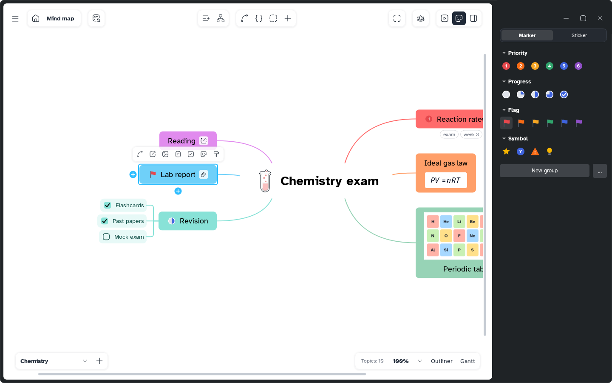

[Manual](../README.md) › [Topic contents](README.md) › Markers

# Markers

Markers are small icons before the title: a priority, progress, a flag or a symbol.

## Add a marker

1. Select one or more topics.
2. Click **Markers and stickers** at the top right, or choose **Insert content** › **Marker**.
3. On the **Marker** tab, click a marker; **Search markers** finds one by its English name. Click it again, on topics that all have it, to remove it.

| Series | Markers |
|---|---|
| **Priority** | 1 to 6 |
| **Progress** | 0, 25, 50, 75 and 100 % |
| **Flag** | Red, orange, yellow, green, blue, purple |
| **Symbol** | Star, Question, Warning, Idea |

> [!NOTE]
> A topic has one marker per series: a new priority replaces the old one.

## Change and remove

- Click a marker on the topic to step to the next of its series: priority 1 becomes 2.
- Right-click it to pick another of the series, or **Remove marker**.

## Add your own markers

**New group** creates your own series. The **…** button adds icons from a file or a folder, and restores the built-in collections.
