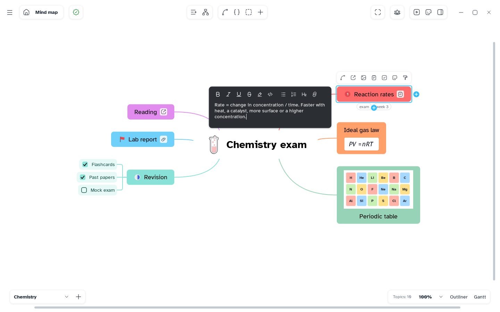

[Manual](../README.md) › [Topic contents](README.md) › Notes

# Notes

A note keeps the details of a topic one click away, so the map stays short.

## Write a note

1. Select a topic.
2. Click **Add a note to the topic** in the topic bar, or press <kbd>Ctrl</kbd>+<kbd>Shift</kbd>+<kbd>N</kbd>.
3. Type in the box beside the topic. Click outside or press <kbd>Esc</kbd> to save.

Or: **Insert content** › **Note**.

The editor bar has **Bold** (<kbd>Ctrl</kbd>+<kbd>B</kbd>), **Italic** (<kbd>Ctrl</kbd>+<kbd>I</kbd>), **Underline** (<kbd>Ctrl</kbd>+<kbd>U</kbd>), **Strikethrough**, **Highlight**, **Code**, **Bulleted list**, **Numbered list**, **Heading** and **Link**. <kbd>Ctrl</kbd>+click opens a link in a note.

> [!TIP]
> Text between dollar signs, such as `$E = mc^2$`, is drawn as a formula.

## Read notes

- Hover the note icon on a topic to read the start; click it to open the note.
- **Show all notes**, on the **Map** page of the side panel, shows every note inside its topic.
- In the [outliner](../outliner/outliner.md) the note sits under the title, and you can write it there.

## Remove a note

Open the note and delete its text.
