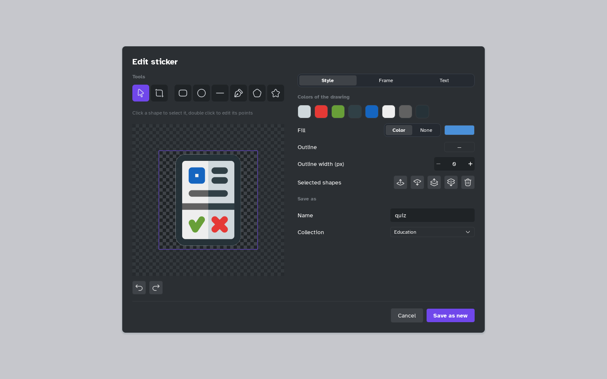

[Manual](../README.md) › [Topic contents](README.md) › The sticker editor

# The sticker editor

Recolour, crop, label or draw on a sticker and save it as a new one.

## Open the editor

On the **Sticker** tab of the side panel, right-click an SVG sticker › **Edit…**.

## Draw and crop

- **Select**: move and resize shapes; double-click a shape to edit its points.
- **Frame**: drag the edges to crop.
- **Rectangle**, **Ellipse**, **Line**, **Pen**, **Polygon**, **Star**: draw a shape; <kbd>Shift</kbd> keeps it regular.

Undo with <kbd>Ctrl</kbd>+<kbd>Z</kbd>, redo with <kbd>Ctrl</kbd>+<kbd>Y</kbd>, or the arrows under the drawing.

## Change colours, frame and text

| Page | What you can change |
|---|---|
| **Style** | **Colors of the drawing** (click one to change it everywhere); **Fill**, **Outline**, **Outline width (px)**, order and **Delete** of the selected shapes. |
| **Frame** | **Rotate**, **Flip**, **Angle (°)**, **Fit to the drawing**, **Margin (%)**. |
| **Text** | A word or number, with **Font**, **Size (%)**, **Color** and **Bold**. |

## Save the sticker

Enter a **Name**, choose a **Collection** and click **Save as new**. The original stays; for a sticker of yours, Mentis asks whether to delete it.
