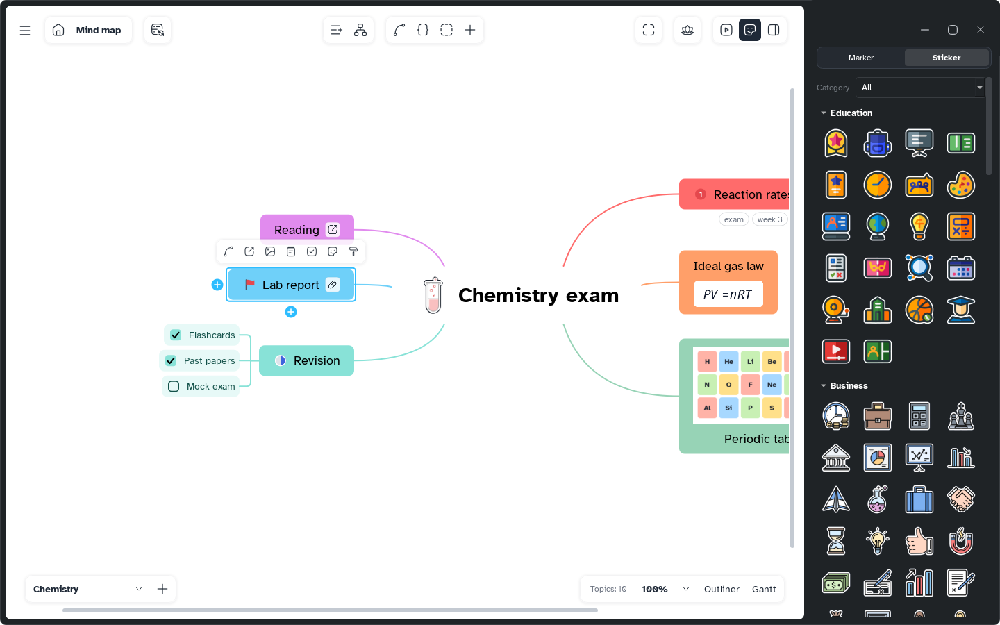

[Manual](../README.md) › [Topic contents](README.md) › Stickers

# Stickers

Stickers are ready drawings for a topic (objects, animals, school things, food), sorted in collections.

## Add a sticker

1. Select one or more topics.
2. Click **Add a marker or a sticker to the topic** in the topic bar, or choose **Insert content** › **Sticker…**.
3. On the **Sticker** tab, click a sticker. Type in **Search stickers** to find one by its English name or its collection, or pick a **Category** to see fewer.

The sticker takes the place of a picture: resize, move and remove it like an [image](images.md). The **Style** page adds **Sticker outline**, an edge that keeps it visible on any colour.

## Organize the library

- **New collection** makes your own collection.
- The **…** button: **Add from file…** (Mentis asks a name for each file), **Import a folder…** (the file names stay), **Restore built-in collections**.
- Right-click a collection › **Rename…**, **Hide** (built-in) or **Delete…** (yours).
- Right-click a sticker › **Move to**, **Edit…** or, for ones you added, **Rename…** and **Remove from the collection**.
- Drag stickers and collections to reorder them.

SVG stays sharp at any size; PNG works too. A file can be up to 2 MB.
